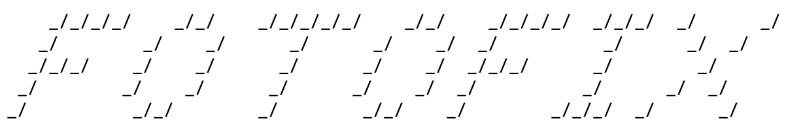

<!-- KOPFZEILE START -->

  
  <h1>FOTOFIX</h1>
  
The FOTOFIX Client implementation for MVS 3.8j

  
bridging the vintage OS into the modern world

  <!-- Optionale Badges für mehr Style -->

<!-- KOPFZEILE ENDE -->

The source code has been - except for the Python bridge part, been entirely created on MVS 3.8j using MVS tools. Don't expect the code to build or 
run in your environment. It also greatly depends on ASCII art provided to the FOTOFIX client through the Python bridge. Feel free to mock this by 
providing a 132 cols x 66 lines ASCII art file of your own by your own access method. 
When it comes to JES2 printout, I adapted this to my printer handling code outside Hercules. The code here just puts the print to a SYSOUT class 
and JES2 may try to put it on one printer you have defined. 

## 💖 CREDITS
*   **[Edwin Freekenhorst](https://www.linkedin.com/in/edwin-freekenhorst-44ab0a/)** – who inspired me with his work on SNA, VTAM, 3705 emulation.
*   **[Tony Winslow](https://github.com/twinslow)** – who threw my BSC-over-2703 TCU-to-Python craze to Claude who created an exremely helpful PoC which is also available on github.
*   **[Rob Prins](https://www.prince-webdesign.nl/tk5)** – for his wisdom and help, especially with the assembly language deep dives.
*   **Bob Polmanter** – who taught me the basics of S/370 assembly language with great patience. You made me embrace assembly and dearly love it.
*   **[Mike Noel](https://www.kicksfortso.com/)** - for having created KICKS for TSO - the transactions coded in COBOL are the friendly face to the FOTOFIX users, that is, the attendees 
of the "Classic Computing 2026" exhibition.
*   **[Jay Moseley](https://www.jaymoseley.com/)** - who is always extremely helpful with everything
*   **Doug Wegscheid** - for your wisdom and advice
*   **Harold Grovensteen** - for your wisdom and advice
*   **Zachary Kline** - for your wisdom and advice
*   **Ross Patterson** - for your wisdom and advice
*   **Tony Harminc** - for your wisdom and advice
*   **Greg Price** - for your wisdom and advice
*   **[Hans Hübner](https://github.com/hanshuebner)** - for his continued support and sweet-talking his wife into bringing the 3179 along to the show :-)

and not to forget to mention all those not mentioned. Without you, I likely would have failed to deliver the MVS flavour of FOTOFIX at the
"Classic Computing 2026" exhibition.

Areas tackled by the FOTOFIX project are:

* pseudo-conversational COBOL transactions for CICS (KICKS)
* BMS 3270 screen maps
* assembler subroutine calls from COBOL
* RAKF
* Dynamic File allocation
* VSAM KSDS entry, read, update
* ENQ and DEQ function of MVS to provide transactional sharing of VSAM between address spaces
* BTAM and the BSC line protocol
* Submitting JCL from a program through the internal reader
* TSO command creation

It was a very bumpy journey and obstacles surfaced in abundance during that journey. As far as MVS is concerend, the FOTOFIX programs are fully implemented with the
capabilities of MVS of the early 80'. The magic to interface to the "modern" world fetching a pre-rendered file from a unix or VMS server by communicating with
a "bridge" programmed in Python is provided by Hercules and the 2703 TCU emulation that converts BSC into TCP/IP streams while retaining the high level BSC protocol.
